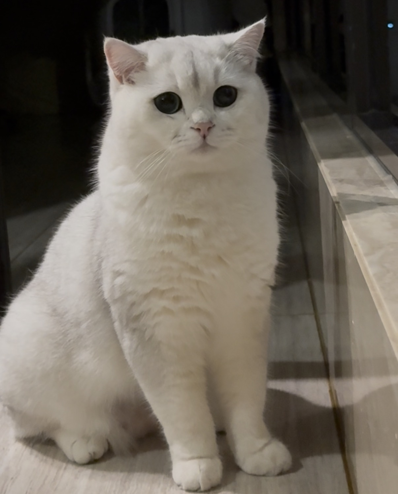

My academic path has taken me from Wisconsin to Singapore, Chicago, and Seattle, combining training in economics, mathematics, social science, and marketing analytics.

Before starting my PhD, I completed internships spanning financial analysis, market research and consulting, and technology.

## Outside Research

:::: {.columns}

::: {.column width="62%"}

Outside of research, I am a cat mom, a dancer, and an enthusiastic home cook. I am also a foodie who loves exploring local coffee roasters and trying new restaurants.

I am currently learning tennis, though reaching 3.0 may still be a few hundred million lessons away.

:::

::: {.column width="38%"}

::: {.text-center}

{fig-alt="A photo of my cat" width="60%"}

*My favorite research assistant BenBen*

:::

:::

::::